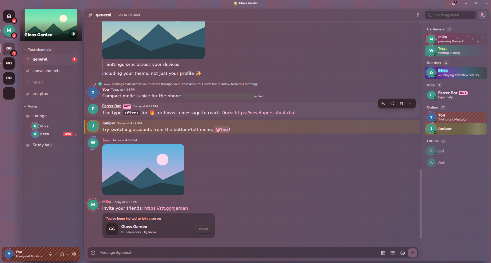
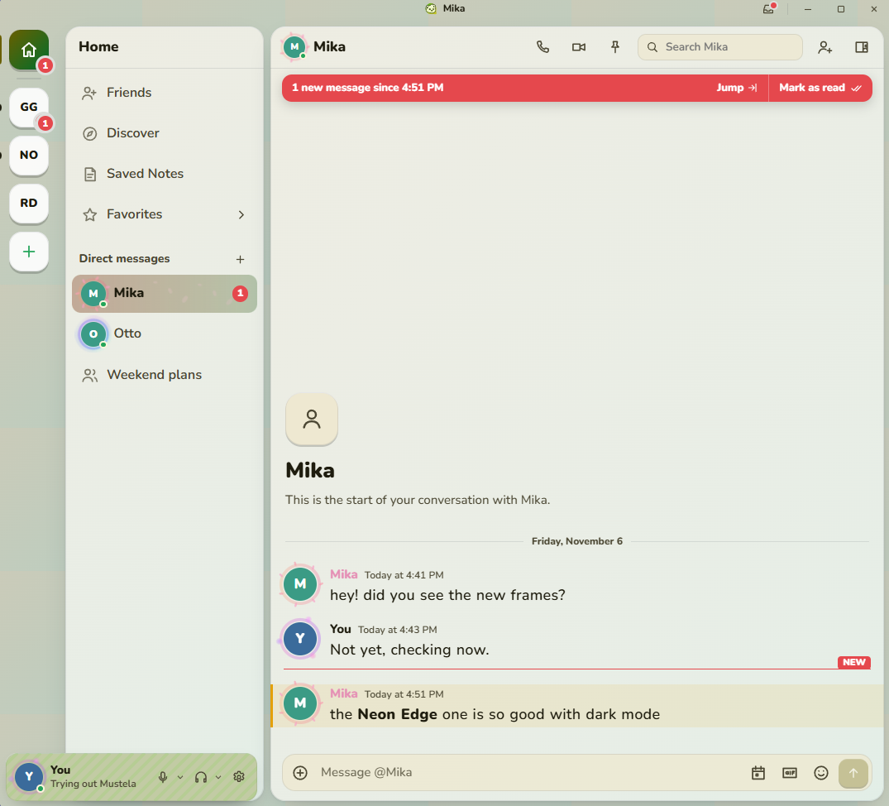
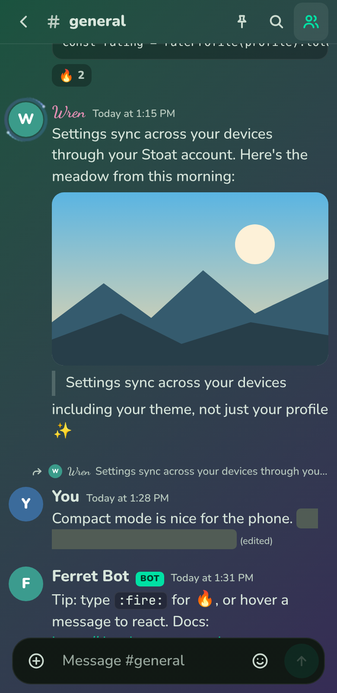
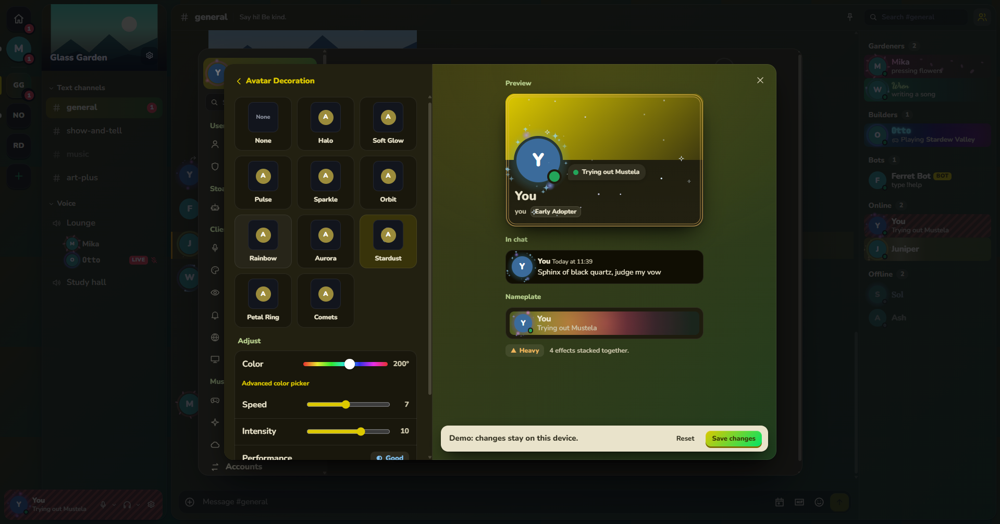

<p align="center"></p>

<h1 align="center">Mustela</h1>

<p align="center">A <a href="https://stoat.chat">Stoat</a> client for Windows, macOS, Linux and Android.<br>Voice, video, screen share, profile decorations, and a look of its own.</p>

<p align="center"></p>
<p align="center"> </p>
<p align="center"></p>

Mustela is a third-party client for Stoat (the chat platform that used to be called Revolt). It signs in to your
normal Stoat account, on stoat.chat or a self-hosted instance, and talks to the same servers, channels and people as
Stoat's own apps. Everything you do in Mustela shows up in Stoat and the other way around.

The name comes from *Mustela erminea*, the stoat's scientific name.

Everything Stoat's apps do, Mustela does too, including voice, video and screen share. This page lists what
Mustela adds on top.

## Contents
- [Highlights](#highlights)
- [What Mustela adds](#what-mustela-adds)
- [Download](#download)
- [Build it yourself](#build-it-yourself)
- [Develop](#develop)
- [With or without a sync server](#with-or-without-a-sync-server)
- [Hosting a sync server](#hosting-a-sync-server)
- [Game activity and Rich Presence](#game-activity-and-rich-presence)
- [Status](#status)
- [Credits](#credits)

## Highlights
- **Themes**: Mustela's own themes and your saved looks, with rich colours across the whole window
- **Profile decorations**: avatar decorations, profile effects, card frames, nameplates and name effects
- **Calls with extras**: stream sound, a soundboard, per-person volume and a call you can pop out
- **Opens instantly** and connects in the background
- **Android notifications** even while Mustela is closed, without showing you online
- **Scheduled messages**, favorites, pinned DMs and server folders
- **Game activity and Rich Presence**, like Discord's

## What Mustela adds

### Calls
- Stream sound: share a single app's audio, or everything except Mustela, in stereo
- Your own picker for a whole screen or one app window
- Per-person volume up to 200%, and "mute for me" for a person or just their stream
- A soundboard: add clips from a file or a link, trim, search and favorite them, play them into the call (even while
  you're muted), and set a sound for when you join
- Pop the call out into its own window and back without dropping it
- On Linux systems whose WebKitGTK has no WebRTC, voice still works (the call runs natively in Rust)
- On Android: a floating call bubble over other apps, and picture-in-picture that shows the stream or whoever is talking

### Profiles
Seen by other Mustela users. Stoat's apps just see your normal profile.
- Avatar decorations, profile effects (petals, snow, fireflies and more), card frames and nameplates
- Name fonts and name effects, and profile colours
- A profile editor with a live preview, and a different look per server
- Choose who can see your Mustela profile: everyone, friends, or friends plus servers you pick
- Every decoration has a performance rating, and you choose the heaviest thing you're willing to see animated
- Activity: the game you're playing (detected automatically) and Rich Presence, with song progress and buttons

### Chat and servers
- Scheduled messages: right-click (or hold) Send to pick when it goes out
- Favorite channels from any server, in your own categories, or with their own button on the server list
- Pin channels to the top of a server, pin DMs into named, coloured groups, and server folders with any colour
- Search with tabs for media, links and files, and Home search (Ctrl+K on desktop) to jump to anyone or any chat
- A friends page that shows who's in voice, who's streaming and what they're playing
- Previews with every picture or a playable video for X, Instagram, TikTok, Reddit, Bluesky, Fur Affinity, pixiv,
  DeviantArt, Tumblr and Threads, including the "fix the embed" links people paste (fxtwitter, kkinstagram, rxddit…)

### Look
- Themes: one tap sets the colours, gradient and background. Mustela comes with a set of dark and light ones, and you
  can save your own look as a theme
- A 3D style with floating panels and chunky buttons, or flat
- Backgrounds: stars, gradient or your own picture, with see-through panels
- Window materials on desktop (Mica and Acrylic on Windows, vibrancy on macOS)
- Android 12+ can follow your wallpaper colours

### Desktop and phone
- Opens instantly and connects in the background
- Android: notifications while Mustela is closed, with Reply and Mark as read, checked without showing you online
- Several accounts with quick switching
- Tray icon with mute, deafen and leave, and closing the window keeps Mustela running there
- Updates itself from GitHub releases; the Linux AppImage can install itself into your menu
- Tablets use the phone layout held upright and the desktop layout sideways
- A Performance page: pause animations in the background, lighter in calls and big servers

## Download

Grab the latest build from [Releases](../../releases/latest).

| System | File |
|---|---|
| Windows 10/11 | `.exe` installer |
| macOS (Apple Silicon and Intel) | `.dmg` |
| Linux | `.AppImage` |
| Android | `.apk` |

The builds aren't code-signed, since that needs paid certificates. On macOS, right-click the app and choose **Open**
the first time. On Windows, if SmartScreen pops up, click **More info** and then **Run anyway**.

## Build it yourself

You don't need to install anything first. The build script works out what's missing and offers to install it:

| Missing | What the script does |
|---|---|
| Node.js | `build.sh` / `build.cmd` download a private copy into `~/.mustela/toolchain` |
| Rust | runs the official rustup installer (your user only) |
| Xcode command line tools (macOS) | opens Apple's installer and waits for it |
| Visual Studio C++ build tools (Windows) | installs them with `winget` (asks first) |
| WebKitGTK and friends (Linux) | installs them with apt, dnf, pacman or zypper (asks for your password first) |
| Java 17, Android SDK, NDK | downloads them into `~/.mustela/toolchain` (about 1.7 GB, asks first) |

If you already have any of these (Android Studio, Homebrew Java and so on), they get used.

```sh
git clone https://github.com/suxhi-space/mustela.git
cd mustela
./build.sh          # macOS / Linux
build.cmd           # Windows
```

It asks which platform you want, the version number, and which GitHub repository the app should check for updates
(`suxhi-space/mustela`, your own fork, or `none`). For Android it also asks for the package name. Finished files go in
`release/<platform>/`.

To skip the questions:

```sh
./build.sh --platform linux --version 0.2.0 --repo you/mustela
./build.sh --platform android --package app.mustela.client
./build.sh --platform android --debug
```

| Platform | Build on | You get |
|---|---|---|
| Windows | Windows 10/11 | `.exe` installer and `.msi` |
| macOS | a Mac | Universal `.app` and `.dmg` |
| Linux | Linux | `.AppImage` and `.deb` |
| Android | any of the above | signed `.apk` and `.aab` |
| Web | anywhere | a static site in `release/web` |

Desktop apps can only be built on their own system. To build everything from one place, push to GitHub and run
**Actions > Release** (or push a tag like `v0.2.0`), which drafts a release with all the files.

### Android signing

The first release build makes a signing key in `~/.mustela/android-signing`, outside the source folder, so every
copy of the source signs the same way. Android only installs an update if it's signed with the same key as the app
already on the phone, so **back that folder up and never share or commit it**. For GitHub builds, add the key as
repository secrets: `ANDROID_KEYSTORE_BASE64`, `ANDROID_KEYSTORE_PASSWORD`, `ANDROID_KEY_ALIAS`, `ANDROID_KEY_PASSWORD`.

### Releases and updates

Installed copies check the repository's published releases and read the version from the file names
(`Mustela_0.1.3-build6_windows_x64.exe`), not from the tag, so keep the file names the build script gives you.
Windows and the AppImage update themselves; macOS and `.deb` open the download; phones open the release page.

### Change the icon

Replace `icons/app-icon.png` (1024×1024) and build. See [`icons/README.md`](icons/README.md).

## Develop

```sh
npm install
npm run dev          # in the browser at http://localhost:1420, "Explore the demo" needs no account
npm run dev:mobile   # the same with the phone and tablet screens
npm run tauri dev    # the desktop app with hot reload
npm test
npm run typecheck
```

```
src/lib/        app logic: the Stoat connection, the demo, markdown, profiles, sync, themes
src/ui/         the interface (Solid) and styles.css, shared by both sets of screens
src/desktop/    desktop start-up (Windows, macOS, Linux)
src/mobile/     phones and tablets: start-up, swipes and touch styles (only in the Android build)
src-tauri/      the desktop side in Rust: windows, screen capture, Linux voice, game detection, Rich Presence, updates
src-tauri/plugins/mustela-native/   Android: calls, the call bubble, screen share, wallpaper colours (Kotlin)
server/         the sync server you can host
scripts/        the build script
```

## With or without a sync server

Mustela works fully on its own. A sync server only adds the things Stoat has no place for.

| | Without a sync server | With one |
|---|---|---|
| Everything in Stoat, calls, themes, scheduled messages, notifications | ✓ | ✓ |
| Your settings (colours, themes, profile, favorites, pins) on every device you sign in on | ✓ saved in your Stoat account | ✓ |
| Your decorations, effects, frames and colours seen by other Mustela users | ✓ if your profile is public (carried in your banner) | ✓ |
| A private profile (friends, or friends plus servers you pick) | | ✓ |
| A different look per server | Nickname and picture (Stoat keeps those, everyone sees them) | Also banner, about me, decorations, name style and colours |
| What you're playing (game activity and Rich Presence) seen by others | | ✓ |

### How profiles reach other people

**Your banner.** Your profile settings fit in about 20 bytes. When you publish, Mustela re-uploads your Stoat banner
a little taller, with those bytes drawn as a thin strip of grey blocks below the picture. Other Mustela users read the
strip and draw your decorations on their side. Nobody sees the strip: Mustela hides it, and Stoat's apps only show the
middle of a banner, so it stays out of view there too. The strip is only data, it can't run anything, and since every
effect is drawn on the viewer's device from a few numbers, nobody can make a profile that lags your phone. This only
carries a public profile.

**A sync server.** A small server anyone can run (see below). Link it in **Settings > Sync & servers** and Mustela
publishes your profile, your per-server looks and your activity there, and reads other people's from the servers
you've added. To see someone's private profile or activity, you need a sync server in common with them.

## Hosting a sync server

It's in [`server/`](server): one file, no dependencies, Node 20 or newer.

```sh
cd server
PORT=8787 DATA_DIR=./data node server.mjs
# or with Docker
docker build -t mustela-sync server && docker run -p 8787:8787 -v mustela-data:/data mustela-sync
```

Put it behind HTTPS (Caddy, nginx, a Cloudflare tunnel) and add its address in **Settings > Sync & servers**.
Settings are environment variables: `PORT`, `HOST`, `DATA_DIR`, `NAME`, `STOAT_APIS` (which Stoat instances can link,
default `https://stoat.chat/api`) and `TRUST_PROXY=1` behind a reverse proxy.

It stores your profile settings, banners you made for particular servers (images only, 512 KB max) and, in memory
only, your current activity. When you link it, it asks your Stoat instance once who the session belongs to. It never
stores or logs your session. Only you can change your profile, and if you made it private only the people you
allowed can read it. Version 1.3 keeps Rich Presence buttons; older servers still work for everything else.

## Game activity and Rich Presence

On desktop, Mustela checks running programs against Discord's public list of detectable games, and listens on the
same local socket games use for Discord Rich Presence. That's how games that show details ("Ranked, 2-1", the song
that's playing) show them in Mustela too.

It works with Discord open. Whichever starts first gets the socket. If that's Mustela, it passes everything through
to Discord untouched, so your Discord friends still see what you're playing. Mustela never sets anything on Discord
itself. Turn either part off, or hide a game, in **Settings > Activity**.

## Status

This is a beta. It's being used day to day on Windows, macOS, Linux and Android, but expect rough edges, and please
open an issue when something breaks.

Known limits:
- On Linux, sign-in stays in the app's own storage when no keyring (GNOME Keyring, KWallet) is running. Everywhere else it's in the system keychain.
- Linux window blur only shows if your desktop blurs windows (KDE can).
- Stoat's search only matches words, so the media, links and files tabs look through recent history.
- Screen share is 720p, or 1080p if your Stoat account allows it. 60 fps waits on Stoat.
- Rich Presence only reaches Mustela if Mustela started before Discord. Game detection works either way.
- No iPhone or iPad build yet.

## Credits

Built with [Tauri](https://tauri.app), [Solid](https://www.solidjs.com),
[stoat.js](https://github.com/stoatchat/javascript-client-sdk), [LiveKit](https://livekit.io), Google's
[Material Color Utilities](https://github.com/material-foundation/material-color-utilities) and the
[Nunito](https://fonts.google.com/specimen/Nunito) typeface. Not affiliated with Stoat. Profile decorations are
original, drawn in code, and no artwork from anyone else is included.
