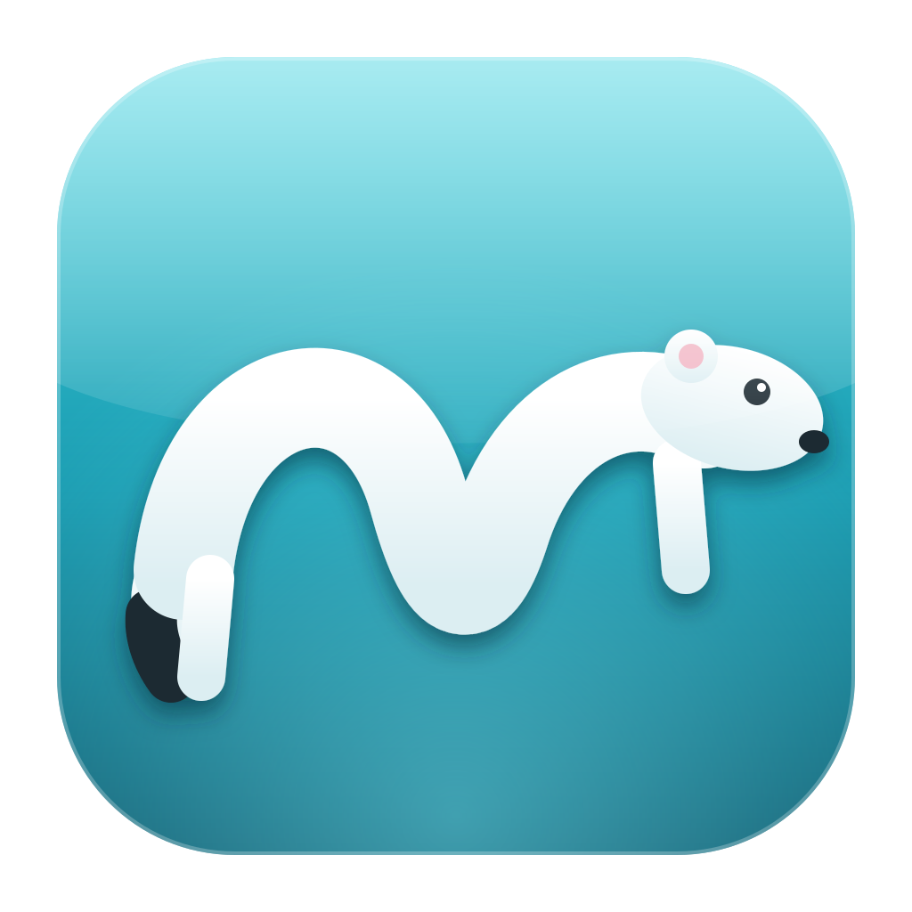
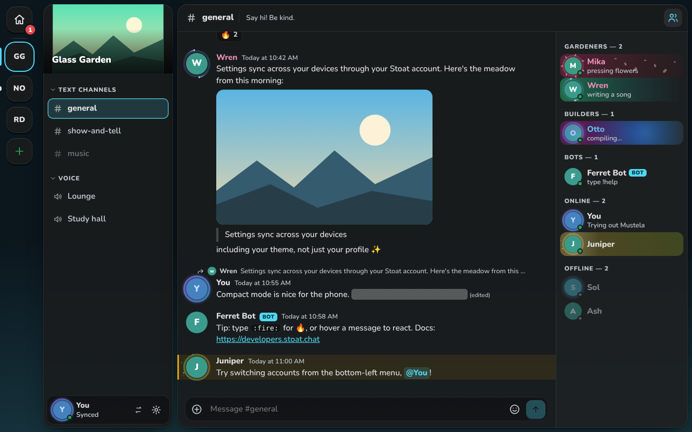
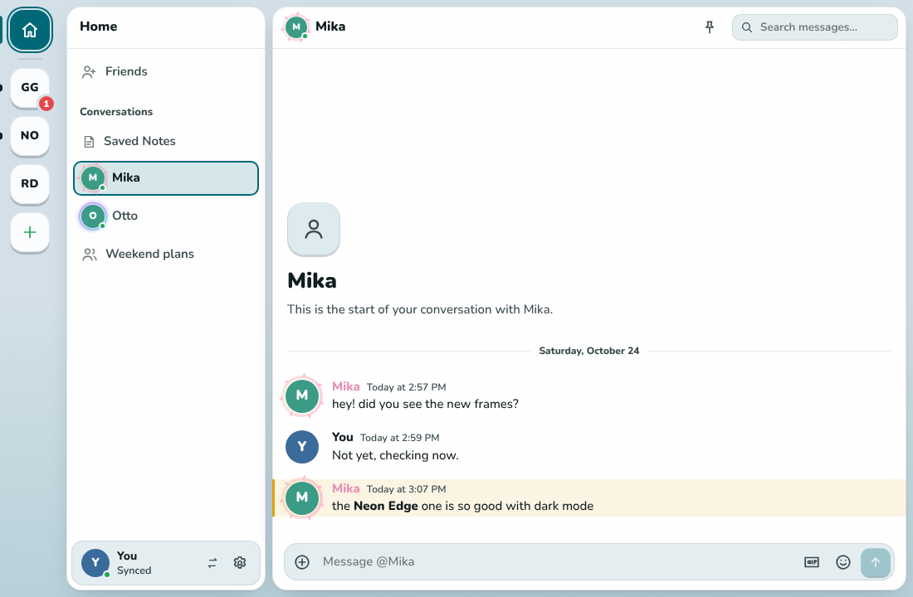
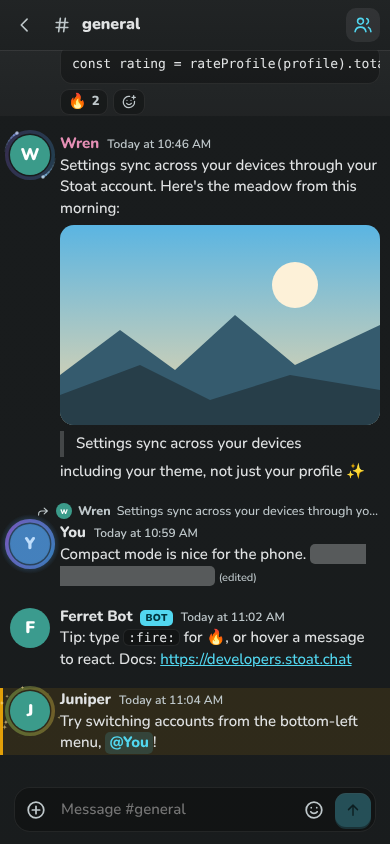
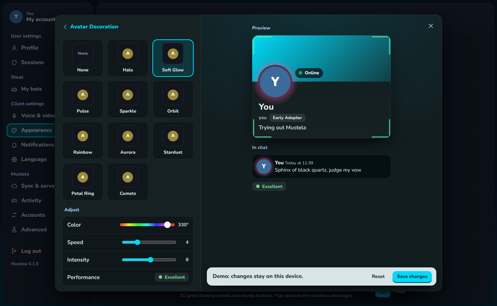

<p align="center"></p>

<h1 align="center">Mustela</h1>

<p align="center">A <a href="https://stoat.chat">Stoat</a> chat client for Windows, macOS, Linux and Android,<br>with style profile customization and a tactile, 3D look.</p>

<p align="center"></p>
<p align="center"> </p>
<p align="center"></p>

Mustela connects to Stoat (formerly Revolt), on stoat.chat or a self-hosted instance. It keeps Stoat's familiar
layout: servers on the left, channels, chat, members. It adds profile decorations, effects, frames and nameplates
that other Mustela users can see, game activity like Discord's, a soundboard, and an optional sync server you can host yourself.

## Features

**Chat**
- Servers with categories, server banners, unread and mention badges, muting respected
- Home like Stoat's: Friends, Discover (Stoat's servers and bots, joining in-app), Saved Notes on top, then your DMs
- Pin DMs into named, colored groups that sync to your other devices
- DMs like Discord's: call and video buttons, add friends to make a group, their profile beside the chat
- Friends with an "Active now" column: who's in voice (and where), who's streaming, what they're playing
- An inbox in the title bar for unreads and mentions, grouped by server
- Server folders, the same ones Stoat's client makes and syncs: drag a server onto another to make one
- Messages with Stoat markdown: **bold**, *italic*, ~~strike~~, `code`, code blocks, quotes, lists, headings, `||spoilers||`, links, mentions, custom emoji, timestamps
- Replies (with mention toggle), reactions, edit (or press ↑), delete, copy, pin
- Right-click menus everywhere: messages, people, channels, servers, links and images
- Images, video, audio and files: send by button, paste or drag-and-drop, with upload progress; view in a lightbox
- GIFs (Stoat's GIF search), with favourites that sync to your other devices
- Emoji drawn in Stoat's packs (Fluent 3D by default, Fluent Color and Flat, Mutant, Noto, Twemoji) or your system's
- Link previews, YouTube/Twitch/Spotify cards, and invite cards with a Join button (the bare link is hidden, like Stoat and Discord)
- A message that's only emoji shows them big; hover any emoji to see its name and, for custom emoji, its server
- Server emoji in the picker and `:shortcode` autocomplete, `@mention` autocomplete
- Message search and pinned messages, with jump-to-message into older history
- Typing indicators, older history as you scroll up, jump to present
- Read state syncs with Stoat (and the official app); server order and folders too, with drag-to-reorder
- Notifications per server and channel (all, mentions, nothing, mute for a while), synced with Stoat
- Join servers from an invite link, or create your own
- Server settings: overview, icon and banner, channels, roles, emoji, members (kick, ban), invites, bans
- Multiple accounts with a one-tap switcher; status and status message from the account menu

**Voice and video**
- A full call view like Discord's: everyone in tiles, click a stream to make it big, full screen, the channel's chat beside it
- Calls in DMs and groups, shown above the conversation
- Voice, camera and screen share (LiveKit, through Stoat's call API, with Stoat's screen share settings), mute and deafen
- Right-click anyone in a call: their volume up to 200%, mute them, their stream's volume, stop watching
- Speaking rings that keep up with the voice, and quick emoji reactions in calls
- Servers with people in voice show a speaker on their icon; profiles say when someone's in voice or streaming
- Input sensitivity (automatic, or a threshold with a live meter), echo cancellation, noise suppression, device choice
- Local soundboard: add clips from a file or a link (MyInstants, Soundboard Buttons, Sound Buttons World, direct MP3), trim to 10 seconds, play them into the call; an entry sound when you join
- Pop-out call window on desktop, like Discord's: the call moves into its own thin window and back
- On Android, calls keep going when you swipe the app away (background call service), or float in picture-in-picture with the web call engine

**Profiles** (seen by other Mustela users)
- A profile editor window with a live preview, like Discord's: name, avatar, banner, about me, decorations, name style, colors
- Avatar decorations (drawn behind your picture, never over it), profile effects (falling petals, snow, fireflies…), profile frames that trace the card's edge, nameplates
- Profile theme colors and display-name fonts and effects
- Activity: "Playing …" from game detection and Discord Rich Presence, kept separate from your status like Discord
- Every item has a performance rating (Excellent, Good, Heavy, Very Poor). You choose the heaviest thing you'll see animated.

**Look**
- *3D*: panels float over a starfield (or your own picture) with chunky, pressable buttons, in the spirit of VRChat's menus. *Flat*: the same layout without depth.
- 9 color themes plus any custom color, each in light and dark, with an optional pure black mode
- Material You palette styles like Stoat's (Monochrome, Neutral, Tonal spot, Vibrant, Expressive, Fidelity, Content, Rainbow, Fruit salad), four contrast levels, and a gradient accent
- Android 12+ can follow your wallpaper colors (Material You)
- Window materials on desktop: Mica, Acrylic and Blur on Windows, Vibrancy on macOS, with a thin title bar like Discord's
- Your nameplate, status and talking ring in the bottom-left panel, with mute, deafen and your own card a click away
- Message size, group spacing and font, like Stoat's Display & text
- Compact, default and comfy density; cozy or compact messages
- Settings sync across your devices through your Stoat account

**Desktop**
- Tray icon with mute, deafen and leave, showing when you're in a call; closing the window keeps Mustela in the tray
- Start with your computer, a single running copy, and on Linux a one-click AppImage install into ~/Applications with menu and desktop shortcuts
- Windows installs to Program Files

**Settings**: in Stoat's order (My account with username, email, password, recovery codes and authenticator; Sessions; My bots; Voice & video; Appearance; Notifications; Language; Desktop) plus Mustela's own: Activity, Sync & servers, Accounts and Advanced. Settings open over a blurred app, like the profile editor.

## Build it yourself

You don't need to install anything first. The build script finds what's missing and offers to install it:

| Missing | What the script does |
|---|---|
| Node.js | `build.sh` / `build.cmd` download a private copy into `~/.mustela/toolchain` |
| Rust | runs the official rustup installer (your user only) |
| Xcode command line tools (macOS) | opens Apple's installer and waits for it |
| Visual Studio C++ build tools (Windows) | installs them with `winget` (asks first) |
| WebKitGTK & friends (Linux) | installs them with apt, dnf, pacman or zypper (asks for your password first) |
| Java 17, Android SDK, NDK | downloads them into `~/.mustela/toolchain` (about 1.7 GB, asks first) |

Existing installs (Android Studio, Homebrew Java, etc.) are found and reused. Pass `--yes` to accept every prompt.

```sh
git clone https://github.com/YOUR-NAME/mustela.git
cd mustela
./build.sh          # macOS / Linux
build.cmd           # Windows
```

The script asks which platform to build, the **version number** for this release, and the **GitHub repository** the app
should check for updates (for example `you/mustela`, or a `github.com/you/mustela/releases/latest` link; `none` turns
update checks off). It checks your setup and tells you exactly what's missing.
It then installs dependencies, generates icons and builds. Finished files land in `release/<platform>/`.

To skip the menu:

```sh
./build.sh --platform linux        # or: windows, macos, android, web
./build.sh --platform android --debug
./build.sh --platform linux --version 0.2.0 --repo you/mustela
npm run app -- --platform linux    # same thing through npm
```

| Platform | Build on | You get | Extra setup |
|---|---|---|---|
| Windows | Windows 10/11 | `.exe` installer, `.msi` | installed for you (Visual Studio C++ build tools) |
| macOS | a Mac | Universal `.app` and `.dmg` (Apple Silicon + Intel) | installed for you (Xcode command line tools) |
| Linux | Linux | `.AppImage`, `.deb` | installed for you (WebKitGTK dev packages) |
| Android | any of the above | signed `.apk`, `.aab` | installed for you (Java 17, Android SDK + NDK) |
| Web | anywhere | static site in `release/web` | none |

Desktop apps can only be built on their own OS. To build all of them from one place, push to GitHub, open
**Actions > Release > Run workflow** and pick a platform (or *all*). Pushing a tag like `v0.2.0` builds everything
and opens a draft GitHub Release with the files attached.

### Change the icon

Replace `icons/app-icon.png` (1024×1024 PNG) and build. Every platform's icon sizes are generated from it.
See [`icons/README.md`](icons/README.md).

### Android signing

The first release build creates a personal signing key in `.signing/`. **Back that folder up and never commit it.**
Android only installs updates signed with the same key. For GitHub builds, add your key as repository secrets
(`ANDROID_KEYSTORE_BASE64`, `ANDROID_KEYSTORE_PASSWORD`, `ANDROID_KEY_ALIAS`, `ANDROID_KEY_PASSWORD`).

### macOS and Windows warnings

The builds aren't notarized or code-signed (that needs paid Apple/Microsoft certificates). On macOS, right-click
the app and choose **Open** the first time. On Windows, choose **More info > Run anyway** if SmartScreen appears.

## Releases

`.github/workflows/release.yml` builds every platform on GitHub and drafts a release with all the installers:

1. Push a tag such as `v0.2.0` (or `v0.2.0-beta.1`), or run **Release** by hand from the Actions tab.
2. Check the draft release, then publish it. Installed copies only see published releases, and update from them
   (Windows and AppImage install themselves; macOS and .deb open the download; phones open the release page).

Android signing is optional. Without it the APK has a debug key. To sign it, add these repository secrets:
`ANDROID_KEYSTORE_BASE64` (your `.jks` file, base64), `ANDROID_KEYSTORE_PASSWORD`, `ANDROID_KEY_ALIAS` and
`ANDROID_KEY_PASSWORD`. Never commit the keystore (`.signing/` is ignored).

## Develop

```sh
npm install
npm run dev          # browser preview at http://localhost:1420. "Explore the demo" needs no account.
npm run tauri dev    # the desktop app with hot reload
npm test             # unit tests
npm run typecheck
```

```
src/lib/        app logic, no UI: Stoat backend, demo backend, markdown, profiles, sync, themes
src/ui/         Solid components and styles.css
src-tauri/      Rust shell: window materials, pop-out window, safe image/sound fetcher, game detection, Rich Presence socket
server/         the self-hostable sync server
src-tauri/plugins/mustela-native/   Android: wallpaper colors + background call service (Kotlin)
scripts/build.mjs   the build script
icons/          your app icon
```

## How profile customization works

There are two ways your profile reaches other Mustela users. Use either or both (Settings > Sync & servers).

**Sync servers.** A small server anyone can host (below). You link it once; Mustela then publishes your profile and
activity there, and reads other people's from the servers in your list.

**Your banner, no server needed.** Your profile settings pack into about 20 bytes. When you press **Publish**, Mustela re-uploads your Stoat banner
with those bytes drawn as a thin strip of gray blocks along the bottom. Other Mustela clients read the strip and
draw your decoration, effect, frame and nameplate locally. Mustela hides the strip; other Stoat apps show it as a
thin gray bar on your banner. Everything is drawn procedurally on the viewer's device, and the performance rating
is computed from the settings themselves, so nobody can make their profile lag your phone.

## Hosting a sync server

The server is in [`server/`](server): one file, no dependencies, Node 20 or newer.

```sh
cd server
PORT=8787 DATA_DIR=./data node server.mjs
# or with Docker
docker build -t mustela-sync server && docker run -p 8787:8787 -v mustela-data:/data mustela-sync
```

Put it behind HTTPS (Caddy, nginx, a Cloudflare tunnel…), then add its address in **Settings > Sync & servers**.
Options are environment variables: `PORT`, `HOST`, `DATA_DIR`, `NAME` (shown in the app), `STOAT_APIS` (which Stoat
instances accounts may come from; default `https://stoat.chat/api`) and `TRUST_PROXY=1` behind a reverse proxy.

What it stores: your profile settings (decorations, frames, colors, and your look per server), banners you made
for particular servers (version 1.2 and newer; pictures only, 512 KB at most) and, in memory only, your current
activity. To confirm who you are when you link it, the server asks your Stoat instance who owns your session, once;
it never stores or logs the session. Only you can change your profile. Others can read it, unless you made it
private: then only the people you allowed can, and the same goes for your server banners. `npm test` in `server/`
runs its tests. Update a 1.1 server to 1.2 to use per-server banners; everything else works with either.

## Activity and Discord Rich Presence

On desktop, Mustela matches running programs against Discord's public list of detectable games, and listens on the
same local socket Discord uses for Rich Presence, so games that show details on Discord ("Ranked, 2-1") show them in
Mustela. It works with Discord open: whichever app starts first gets the socket, and when that's Mustela it passes
every game's connection on to Discord untouched, so your Discord friends still see what you're playing. If Discord
started first, Mustela takes over the next time Discord restarts; turn on **Start with your computer** to start first.
Mustela never sets a presence of its own on Discord. (If Discord shows "Playing Stoat", that's the official Stoat
desktop app.) Activity is shared through your sync servers and is separate from your status. Turn either source off,
or hide a game, in **Settings > Activity**.

## Status

This is an early release. What has been checked, and how:

| Area | State |
|---|---|
| UI, demo mode, markdown, profiles, themes, build script | Tested: 190+ unit tests, plus clicked through in a browser in light, dark and phone layouts |
| Sync server | Tested (link, publish, read, activity, unlink) against a fake Stoat |
| Linux desktop app | Built with the build script on Linux |
| Stoat connection (login, servers, messages, uploads, friends, sync) | Written against the official `stoat.js` SDK types. **Not yet run against a live Stoat server.** Please report what breaks. |
| Voice, camera, screen share, pop-out | Tried in the demo's simulated call; not yet on a live Stoat call |
| Rich Presence pass-through to Discord, tray, AppImage install | Compiled (`cargo check`); not yet run against Discord |
| Windows, macOS, Android builds | Set up in the build script and GitHub workflow, not yet built |
| Android background calls | Written (Kotlin foreground service + LiveKit Android), not yet compiled or run on a device |

Known limits:
- Sign-in tokens are kept in the app's local storage, not the OS keychain.
- Linux window blur only shows if your desktop's compositor blurs windows (KDE can).
- Android background-call mode is voice only; the Web call engine (Settings > Voice & video) adds camera and picture-in-picture. Screen sharing from Android isn't possible yet: Android's WebView has no screen capture.
- Rich Presence reaches Mustela only when Mustela started before Discord (see above). Game detection works either way.
- Discover and Stoat's emoji packs load from stt.gg and static.stoat.chat, so they need a connection.
- Role permissions are edited in Stoat's web app for now; Mustela edits role names, colors and whether members show under them.

## Credits

Built on [Tauri](https://tauri.app), [Solid](https://www.solidjs.com), [stoat.js](https://github.com/stoatchat/javascript-client-sdk),
[LiveKit](https://livekit.io), Google's [Material Color Utilities](https://github.com/material-foundation/material-color-utilities)
and the [Nunito](https://fonts.google.com/specimen/Nunito) typeface. Not affiliated with Stoat. Profile decorations are original procedural
designs. No artwork from Discord or anyone else is included.
